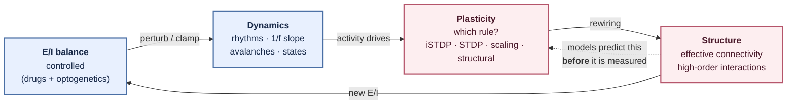

# G07 · E/I mechanisms & plasticity — Group proposal

**Workshop on Whole-Brain Models and High-Order Interactions for Brain Health** · UIB / IFISC · 17–20 Nov 2026

Group G07 theme: *population and E/I models, synaptic plasticity, rhythmic coupling, and state transitions.*

The task (the "game") is to convince the committee to fund a one-year project. The brief says no analysis: the work is the question, the theory, the choice of data and the tools.

This folder holds:

1. **Candidate topics** (section A): six short pitches so the group can choose or merge.
2. **Full one-year proposal** (section B), built on the group's own idea: perturb E/I in the lab, watch the dynamics change, let plasticity rewrite the structure, and use simulations of competing plasticity rules to predict that new structure *before* it is measured. It has a Work Breakdown Structure (WBS), a sheet for every work package, a Gantt chart, milestones, risks and a budget.

---

## A. Candidate topics

| # | Working title | Core question | Lab handle | Model | Workshop link |
|---|---|---|---|---|---|
| T1 | **LOOP-EI**: closing the loop E/I → dynamics → plasticity → structure *(selected, section B)* | If we shift E/I on purpose, can a plasticity rule predict how the network rewires? | Drugs and optogenetics on cultures on multi-electrode arrays (MEAs) | NEST spiking network with plasticity, plus a rate model with inhibitory plasticity | DMF with inhibitory synaptic plasticity (Herzog/Coronel), HOI (Gatica), perturbations (Bao) |
| T2 | **Reading E/I from the outside** | Which non-invasive marker (1/f slope, fE/I, avalanche exponents, gamma power) really tracks E/I when E/I is changed by a known amount? | Graded doses of GABA-A/AMPA drugs, PV/SST optogenetics | Rate model with ground-truth E/I, forward model to LFP/EEG | Aperiodic slope data (Coronel), criticality (Wu) |
| T3 | **Which inhibition sets the rhythm?** | Do PV and SST interneurons control gamma and theta–gamma coupling in different ways, and does plasticity at their synapses keep these rhythms stable? | Cell-type-specific optogenetics | Network of E, PV and SST populations; PING/ING mechanisms | Eigenmode resonance (Cabral), rhythmic coupling |
| T4 | **E/I near the critical point** | Does inhibitory plasticity keep networks near criticality, and do drugs push them away and back? | Recover after GABA blockade | Branching / E–I network with homeostatic plasticity | Criticality (Wu), perturbations (Bao) |
| T5 | **Plasticity leaves a high-order fingerprint** | Do different plasticity rules leave different redundancy/synergy (O-information) signatures in the activity? | Spike trains before and after induced plasticity | NEST spiking network, many rules | HOI and O-information (Gatica, Herzog, Cofré) |
| T6 | **From dish to brain: E/I digital twins** | Can parameters learned from cultures constrain regional E/I and inhibitory plasticity in whole-brain models fitted to human EEG/fMRI? | Cultures as a calibration bench | DMF with inhibitory plasticity across regions | Digital twins (Herzog), brain clocks / aperiodic (Coronel) |

**Why T1.** It is the group's own idea. It covers all four keywords on the G07 card. It is the only option that *tests a prediction* rather than describing data, and the committee will reward that. T2, T4 and T5 come into it as work packages (WP3 and WP4), and T6 is its outlook (WP6).

---

## B. Full proposal

### B1. Title and summary

**LOOP-EI: Closing the loop between excitation/inhibition balance, network dynamics and plastic network structure**

*One-year project · Group G07 · Requested: €498,000 (see B9)*

**Summary.** Many brain disorders, including epilepsy, autism, schizophrenia and ageing, are described as an "E/I imbalance". But E/I is rarely *controlled*, and its effects are rarely followed past the next few minutes. A balanced network does not stay put: its dynamics drive synaptic plasticity, and plasticity changes the structure that produces the dynamics. LOOP-EI follows this loop end to end in four steps:

1. **Perturb**: shift E/I in a known direction and by a known amount, using drugs and cell-type-specific optogenetics in cortical networks on high-density MEAs.
2. **Measure**: track how the dynamics change (spectral slope, rhythms, avalanches, state transitions).
3. **Predict**: before measuring the structure, simulate how candidate plasticity rules would rewire the network, using spiking models in NEST and E–I rate models.
4. **Test**: infer the rewired structure (effective connectivity, high-order interactions) and score which rule predicted it best.

The output is an experimentally ranked set of plasticity rules, a validated toolkit for measuring E/I, and open-source models that can be dropped into the whole-brain digital twins presented at this workshop.

### B2. Pitch for the committee

- **Testable.** Every model makes a prediction that is written down and registered (milestone MS3) before the matching data are analysed. Some rules will be falsified.
- **Ground truth for E/I markers.** Clinicians already use the 1/f slope and fE/I as E/I readouts. We will check them against E/I changes we make ourselves.
- **Covers all of G07.** The project includes population and E/I models, synaptic plasticity, rhythmic coupling, and state transitions.
- **Links to the rest of the workshop.** The rate-model side extends the DMF model with inhibitory synaptic plasticity (`DMF_ISP_numba_EandI.py`) that is already in the workshop materials. The structural readout uses the O-information / HOI tools. Results feed the whole-brain digital twins.
- **Can be done in a year.** It uses in-vitro cultures (fast, cheap, many repeats), commercial MEAs, simulators that already exist (NEST, Brian2/numba rate models), and a schedule with fallbacks (B8).

### B3. Background (short)

- **E/I balance.** Excitation and inhibition are tightly co-tuned in cortex. Balanced-network theory (van Vreeswijk & Sompolinsky; Brunel) explains asynchronous irregular activity. Breaking the balance produces synchrony, oscillations and seizure-like states.
- **Measuring E/I.** Without invasive recordings, E/I is inferred from proxies: the aperiodic (1/f) exponent (Gao et al., 2017), the functional E/I ratio fE/I (Bruining et al., 2020), avalanche and criticality exponents, and gamma power. These proxies have rarely been checked against an E/I change of known size and sign.
- **Plasticity rules.** Candidate rules include:
  - excitatory spike-timing-dependent plasticity (STDP; triplet and voltage-based variants);
  - inhibitory STDP (iSTDP; Vogels et al., 2011), which restores a target rate — the same idea as the inhibitory synaptic plasticity term in the workshop DMF code, `dJ/dt ∝ r_I (r_E − r_target)`;
  - homeostatic synaptic scaling (Turrigiano);
  - structural plasticity, where synapses form and are removed (Butz & van Ooyen; built into NEST).

  Each rule predicts a *different* rewiring after the same perturbation. That difference is what we exploit.
- **Gap.** Studies either perturb and record activity, or model plasticity. None so far closes the loop with a prediction registered *before* the structural readout.

### B4. Objectives and hypotheses

**General objective.** Find out which plasticity rules explain how cortical networks rebuild their structure after a controlled E/I perturbation, and how that new structure changes their dynamics.

| Specific objective | Hypothesis | Test |
|---|---|---|
| O1. Shift E/I in a known direction (↑E, ↓I, ↑I) by graded amounts | Each manipulation shifts measured E/I in the expected direction, in proportion to the dose | Whole-cell gE/gI on a subset of cultures; agreement between proxies |
| O2. Describe the change in dynamics | ↓I flattens the 1/f slope, raises fE/I, makes avalanches larger and bursting more synchronous, and changes gamma and theta–gamma coupling; ↑I does the opposite | Slope, fE/I, avalanche exponents, PAC, transitions between states found by a hidden Markov model (HMM) |
| O3. Build and calibrate competing plasticity models | Rules can be told apart by their structural predictions, even when their short-term dynamics look alike | Spiking (NEST) and rate (E–I / DMF with inhibitory plasticity) models fitted to the data recorded before the perturbation |
| O4. Infer structure after 24–72 h of perturbation and washout | iSTDP combined with homeostatic/structural plasticity predicts the new structure better than excitatory STDP alone | Effective connectivity (transfer entropy, GLM), O-information; score each prediction against the data |
| O5. Close the loop | Feeding the inferred structure back into the model reproduces the dynamics measured after washout (hysteresis, persistent changes of state) | Simulate on the inferred structure and compare with the post-washout recordings |

### B5. Approach

*Blue nodes are measured in the lab; red nodes are where the models make — and are scored on — predictions. The loop is closed: the inferred new structure feeds back as a new E/I state (WP5, objective O5).*

**Experimental system.** Cortical cultures on high-density multi-electrode arrays (MEAs): many electrodes, single-unit resolution, recordings over days. Cultures are cheap, repeatable and easy to reach with both drugs and light, which makes them the right bench for a loop that has to be run many times.

**How E/I is shifted (WP1).** Four conceptual levers, each described here at the level of *what is changed, in which direction, and how the shift is confirmed* — exact agents and protocols are set with the partner lab.

| Lever | Target | Direction | Granularity |
|---|---|---|---|
| Pharmacology | Excitatory (glutamatergic) vs inhibitory (GABAergic) receptor systems | Either way: reduce inhibition to raise E/I, enhance it to lower E/I | Dose-graded, whole-culture, reversible on washout |
| Optogenetics | A specific cell type (pyramidal; PV or SST interneurons) | Depolarise to raise a population's drive, hyperpolarise to lower it | Cell-type-specific, fast, closed-loop capable |
| Chemogenetics | A genetically defined population | Up or down | Slow, chronic — matches the plasticity window |
| Homeostatic challenge | Overall network drive | Silence/over-drive to trigger compensatory scaling | Whole-network, chronic |

Two levers are used together on purpose: drugs are graded but hit the whole dish, while optogenetics is cell-type-specific and fast, so the pair separates *which* inhibition matters (PV vs SST) from a general change in inhibitory tone. Optogenetics is run **closed-loop** — light updates in real time to hold a chosen firing-rate or fE/I setpoint — which turns the perturbation into an E/I *controller* at a known value, not just a push.

Protocol per culture: **baseline → controlled perturbation (chronic, across the plasticity window) → washout**, recorded continuously with periodic snapshots.

**Confirming the shift (WP3).** Direct ground truth on a subset of cells (ratio of excitatory to inhibitory synaptic conductance); population proxies on every recording (aperiodic 1/f slope, functional E/I ratio fE/I, avalanche/criticality exponents, gamma power); and a dose–response curve, where graded doses should move the proxies proportionally and in the predicted direction. Checking these clinical proxies against a *known imposed* shift is itself a deliverable (topic T2).

---

> **Status:** draft in progress. Section A (candidate topics) and section B1–B5 (summary, pitch, background, objectives, approach) are complete. Still to write: WP2 dynamics readout detail, WP4 structure inference, WP5 plasticity models (NEST + rate/DMF), WP6 outlook, and the project-management block (Work Breakdown Structure, work-package sheets, Gantt chart, milestones, risks, budget).