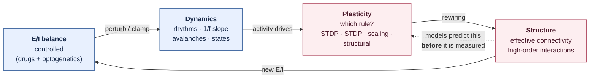
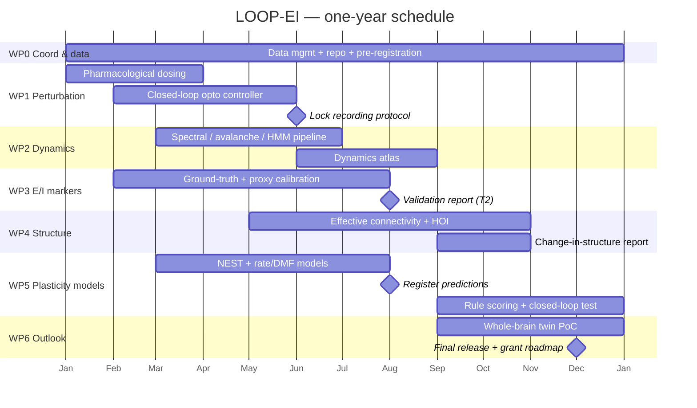

# G07 · E/I mechanisms & plasticity — Group proposal

**Workshop on Whole-Brain Models and High-Order Interactions for Brain Health** · UIB / IFISC · 17–20 Nov 2026

Group G07 theme: *population and E/I models, synaptic plasticity, rhythmic coupling, and state transitions.*

The task (the "game") is to convince the committee to fund a one-year project. The brief says no analysis: the work is the question, the theory, the choice of data and the tools.

This folder holds:

1. **Candidate topics** (section A): six short pitches so the group can choose or merge.
2. **Full one-year proposal** (section B), built on the group's own idea: perturb E/I in the lab, watch the dynamics change, let plasticity rewrite the structure, and use simulations of competing plasticity rules to predict that new structure *before* it is measured. It has a Work Breakdown Structure (WBS), a sheet for every work package, a Gantt chart, milestones, risks and a budget.

---

## A. Candidate topics

| # | Working title | Core question | Lab handle | Model | Workshop link |
|---|---|---|---|---|---|
| T1 | **LOOP-EI**: closing the loop E/I → dynamics → plasticity → structure *(selected, section B)* | If we shift E/I on purpose, can a plasticity rule predict how the network rewires? | Drugs and optogenetics on cultures on multi-electrode arrays (MEAs) | NEST spiking network with plasticity, plus a rate model with inhibitory plasticity | DMF with inhibitory synaptic plasticity (Herzog/Coronel), HOI (Gatica), perturbations (Bao) |
| T2 | **Reading E/I from the outside** | Which non-invasive marker (1/f slope, fE/I, avalanche exponents, gamma power) really tracks E/I when E/I is changed by a known amount? | Graded doses of GABA-A/AMPA drugs, PV/SST optogenetics | Rate model with ground-truth E/I, forward model to LFP/EEG | Aperiodic slope data (Coronel), criticality (Wu) |
| T3 | **Which inhibition sets the rhythm?** | Do PV and SST interneurons control gamma and theta–gamma coupling in different ways, and does plasticity at their synapses keep these rhythms stable? | Cell-type-specific optogenetics | Network of E, PV and SST populations; PING/ING mechanisms | Eigenmode resonance (Cabral), rhythmic coupling |
| T4 | **E/I near the critical point** | Does inhibitory plasticity keep networks near criticality, and do drugs push them away and back? | Recover after GABA blockade | Branching / E–I network with homeostatic plasticity | Criticality (Wu), perturbations (Bao) |
| T5 | **Plasticity leaves a high-order fingerprint** | Do different plasticity rules leave different redundancy/synergy (O-information) signatures in the activity? | Spike trains before and after induced plasticity | NEST spiking network, many rules | HOI and O-information (Gatica, Herzog, Cofré) |
| T6 | **From dish to brain: E/I digital twins** | Can parameters learned from cultures constrain regional E/I and inhibitory plasticity in whole-brain models fitted to human EEG/fMRI? | Cultures as a calibration bench | DMF with inhibitory plasticity across regions | Digital twins (Herzog), brain clocks / aperiodic (Coronel) |

**Why T1.** It is the group's own idea. It covers all four keywords on the G07 card. It is the only option that *tests a prediction* rather than describing data, and the committee will reward that. T2, T4 and T5 come into it as work packages (WP3 and WP4), and T6 is its outlook (WP6).

---

## B. Full proposal

### B1. Title and summary

**LOOP-EI: Closing the loop between excitation/inhibition balance, network dynamics and plastic network structure**

*One-year project · Group G07 · Requested: €498,000 (see B9)*

**Summary.** Many brain disorders, including epilepsy, autism, schizophrenia and ageing, are described as an "E/I imbalance". But E/I is rarely *controlled*, and its effects are rarely followed past the next few minutes. A balanced network does not stay put: its dynamics drive synaptic plasticity, and plasticity changes the structure that produces the dynamics. LOOP-EI follows this loop end to end in four steps:

1. **Perturb**: shift E/I in a known direction and by a known amount, using drugs and cell-type-specific optogenetics in cortical networks on high-density MEAs.
2. **Measure**: track how the dynamics change (spectral slope, rhythms, avalanches, state transitions).
3. **Predict**: before measuring the structure, simulate how candidate plasticity rules would rewire the network, using spiking models in NEST and E–I rate models.
4. **Test**: infer the rewired structure (effective connectivity, high-order interactions) and score which rule predicted it best.

The output is an experimentally ranked set of plasticity rules, a validated toolkit for measuring E/I, and open-source models that can be dropped into the whole-brain digital twins presented at this workshop.

### B2. Pitch for the committee

- **Testable.** Every model makes a prediction that is written down and registered (milestone MS3) before the matching data are analysed. Some rules will be falsified.
- **Ground truth for E/I markers.** Clinicians already use the 1/f slope and fE/I as E/I readouts. We will check them against E/I changes we make ourselves.
- **Covers all of G07.** The project includes population and E/I models, synaptic plasticity, rhythmic coupling, and state transitions.
- **Links to the rest of the workshop.** The rate-model side extends the DMF model with inhibitory synaptic plasticity (`DMF_ISP_numba_EandI.py`) that is already in the workshop materials. The structural readout uses the O-information / HOI tools. Results feed the whole-brain digital twins.
- **Can be done in a year.** It uses in-vitro cultures (fast, cheap, many repeats), commercial MEAs, simulators that already exist (NEST, Brian2/numba rate models), and a schedule with fallbacks (B8).

### B3. Background (short)

- **E/I balance.** Excitation and inhibition are tightly co-tuned in cortex. Balanced-network theory (van Vreeswijk & Sompolinsky; Brunel) explains asynchronous irregular activity. Breaking the balance produces synchrony, oscillations and seizure-like states.
- **Measuring E/I.** Without invasive recordings, E/I is inferred from proxies: the aperiodic (1/f) exponent (Gao et al., 2017), the functional E/I ratio fE/I (Bruining et al., 2020), avalanche and criticality exponents, and gamma power. These proxies have rarely been checked against an E/I change of known size and sign.
- **Plasticity rules.** Candidate rules include:
  - excitatory spike-timing-dependent plasticity (STDP; triplet and voltage-based variants);
  - inhibitory STDP (iSTDP; Vogels et al., 2011), which restores a target rate — the same idea as the inhibitory synaptic plasticity term in the workshop DMF code, `dJ/dt ∝ r_I (r_E − r_target)`;
  - homeostatic synaptic scaling (Turrigiano);
  - structural plasticity, where synapses form and are removed (Butz & van Ooyen; built into NEST).

  Each rule predicts a *different* rewiring after the same perturbation. That difference is what we exploit.
- **Gap.** Studies either perturb and record activity, or model plasticity. None so far closes the loop with a prediction registered *before* the structural readout.

### B4. Objectives and hypotheses

**General objective.** Find out which plasticity rules explain how cortical networks rebuild their structure after a controlled E/I perturbation, and how that new structure changes their dynamics.

| Specific objective | Hypothesis | Test |
|---|---|---|
| O1. Shift E/I in a known direction (↑E, ↓I, ↑I) by graded amounts | Each manipulation shifts measured E/I in the expected direction, in proportion to the dose | Whole-cell gE/gI on a subset of cultures; agreement between proxies |
| O2. Describe the change in dynamics | ↓I flattens the 1/f slope, raises fE/I, makes avalanches larger and bursting more synchronous, and changes gamma and theta–gamma coupling; ↑I does the opposite | Slope, fE/I, avalanche exponents, PAC, transitions between states found by a hidden Markov model (HMM) |
| O3. Build and calibrate competing plasticity models | Rules can be told apart by their structural predictions, even when their short-term dynamics look alike | Spiking (NEST) and rate (E–I / DMF with inhibitory plasticity) models fitted to the data recorded before the perturbation |
| O4. Infer structure after 24–72 h of perturbation and washout | iSTDP combined with homeostatic/structural plasticity predicts the new structure better than excitatory STDP alone | Effective connectivity (transfer entropy, GLM), O-information; score each prediction against the data |
| O5. Close the loop | Feeding the inferred structure back into the model reproduces the dynamics measured after washout (hysteresis, persistent changes of state) | Simulate on the inferred structure and compare with the post-washout recordings |

### B5. Approach

*Blue nodes are measured in the lab; red nodes are where the models make — and are scored on — predictions. The loop is closed: the inferred new structure feeds back as a new E/I state (WP5, objective O5).*

**Experimental system.** Cortical cultures on high-density multi-electrode arrays (MEAs): many electrodes, single-unit resolution, recordings over days. Cultures are cheap, repeatable and easy to reach with both drugs and light, which makes them the right bench for a loop that has to be run many times.

**How E/I is shifted (WP1).** Four conceptual levers, each described here at the level of *what is changed, in which direction, and how the shift is confirmed* — exact agents and protocols are set with the partner lab.

| Lever | Target | Direction | Granularity |
|---|---|---|---|
| Pharmacology | Excitatory (glutamatergic) vs inhibitory (GABAergic) receptor systems | Either way: reduce inhibition to raise E/I, enhance it to lower E/I | Dose-graded, whole-culture, reversible on washout |
| Optogenetics | A specific cell type (pyramidal; PV or SST interneurons) | Depolarise to raise a population's drive, hyperpolarise to lower it | Cell-type-specific, fast, closed-loop capable |
| Chemogenetics | A genetically defined population | Up or down | Slow, chronic — matches the plasticity window |
| Homeostatic challenge | Overall network drive | Silence/over-drive to trigger compensatory scaling | Whole-network, chronic |

Two levers are used together on purpose: drugs are graded but hit the whole dish, while optogenetics is cell-type-specific and fast, so the pair separates *which* inhibition matters (PV vs SST) from a general change in inhibitory tone. Optogenetics is run **closed-loop** — light updates in real time to hold a chosen firing-rate or fE/I setpoint — which turns the perturbation into an E/I *controller* at a known value, not just a push.

Protocol per culture: **baseline → controlled perturbation (chronic, across the plasticity window) → washout**, recorded continuously with periodic snapshots.

**Confirming the shift (WP3).** Direct ground truth on a subset of cells (ratio of excitatory to inhibitory synaptic conductance); population proxies on every recording (aperiodic 1/f slope, functional E/I ratio fE/I, avalanche/criticality exponents, gamma power); and a dose–response curve, where graded doses should move the proxies proportionally and in the predicted direction. Checking these clinical proxies against a *known imposed* shift is itself a deliverable (topic T2).

### B6. Work Breakdown Structure (WBS)

Six work packages. WP0 runs throughout; WP1–WP5 follow the loop (perturb → measure → model → infer → close); WP6 is the outlook to whole-brain models.

```mermaid
flowchart TD
    P["<b>LOOP-EI</b><br/>one-year project"]
    P --> W0["<b>WP0</b><br/>Coordination,<br/>data & reproducibility"]
    P --> W1["<b>WP1</b><br/>E/I perturbation<br/>& control"]
    P --> W2["<b>WP2</b><br/>Dynamics<br/>readout"]
    P --> W3["<b>WP3</b><br/>E/I markers<br/>(ground truth)"]
    P --> W4["<b>WP4</b><br/>Structure<br/>inference"]
    P --> W5["<b>WP5</b><br/>Plasticity models<br/>& rule ranking"]
    P --> W6["<b>WP6</b><br/>Outlook:<br/>whole-brain twin"]

    W1 --> W1a["1.1 Pharmacological dosing"]
    W1 --> W1b["1.2 Closed-loop opto controller"]
    W1 --> W1c["1.3 Perturbation protocol<br/>(baseline/perturb/washout)"]

    W2 --> W2a["2.1 Spectral & rhythms<br/>(1/f, gamma, PAC)"]
    W2 --> W2b["2.2 Avalanches / criticality"]
    W2 --> W2c["2.3 State transitions (HMM)"]

    W4 --> W4a["4.1 Effective connectivity<br/>(TE, GLM)"]
    W4 --> W4b["4.2 High-order interactions<br/>(O-information)"]

    W5 --> W5a["5.1 NEST spiking network<br/>+ plasticity rules"]
    W5 --> W5b["5.2 Rate / DMF model<br/>+ inhibitory plasticity"]
    W5 --> W5c["5.3 Registered prediction<br/>& rule scoring"]

    classDef wp fill:#e8f0fe,stroke:#4a6fa5,stroke-width:2px,color:#1a2b4a;
    classDef sub fill:#f6f8fc,stroke:#9fb3d1,color:#1a2b4a;
    class W0,W1,W2,W3,W4,W5,W6 wp;
    class W1a,W1b,W1c,W2a,W2b,W2c,W4a,W4b,W5a,W5b,W5c sub;
```

### B7. Work-package sheets

Each sheet: objective, tasks, inputs, deliverables, lead role, effort in person-months (PM). Total 48 PM across the team (see B9).

#### WP0 — Coordination, data & reproducibility · M1–M12 · 4 PM
- **Objective.** Keep the project on schedule and make every result reproducible.
- **Tasks.** Project management; shared data standard (NWB for recordings, BIDS-like layout for derivatives); public Git repo; environment pinning (NEST, Brian2/numba, Python); a registered-report-style pre-registration of model predictions (feeds MS3).
- **Inputs.** All WPs.
- **Deliverables.** D0.1 data-management plan (M2); D0.2 public repository + CI (M4); D0.3 pre-registration document (M6); D0.4 final open dataset + code release (M12).
- **Lead.** PI / data steward.

#### WP1 — E/I perturbation & control · M1–M6 · 8 PM
- **Objective.** Shift E/I in a known direction and amount, and hold it at a setpoint.
- **Tasks.** 1.1 graded pharmacological dosing; 1.2 closed-loop optogenetic controller (light tracks a firing-rate / fE/I setpoint); 1.3 baseline→perturbation→washout protocol on MEAs.
- **Inputs.** Cultures, MEA rig, WP3 markers as the control signal.
- **Deliverables.** D1.1 validated perturbation menu with directions (M3); D1.2 working closed-loop controller (M5); D1.3 locked recording protocol (M6).
- **Lead.** Experimental partner.

#### WP2 — Dynamics readout · M3–M9 · 7 PM
- **Objective.** Quantify how the dynamics change under perturbation.
- **Tasks.** 2.1 spectral/rhythm pipeline (aperiodic 1/f, gamma, phase–amplitude coupling); 2.2 avalanche and criticality exponents; 2.3 state-transition detection with a hidden Markov model.
- **Inputs.** WP1 recordings.
- **Deliverables.** D2.1 open analysis pipeline (M6); D2.2 dynamics atlas per condition (M9).
- **Lead.** Dynamics analyst.

#### WP3 — E/I markers & ground truth · M2–M8 · 6 PM
- **Objective.** Calibrate non-invasive E/I proxies against a known imposed shift.
- **Tasks.** direct excitatory/inhibitory conductance ratio on a cell subset; proxy battery (1/f, fE/I, avalanches, gamma) on all recordings; dose–response curves; agreement/validation analysis.
- **Inputs.** WP1 perturbations, WP2 pipeline.
- **Deliverables.** D3.1 proxy-vs-ground-truth validation report (M8) — a standalone result (topic T2).
- **Lead.** E/I-markers analyst.

#### WP4 — Structure inference · M5–M11 · 7 PM
- **Objective.** Infer the network's structure before and after rewiring.
- **Tasks.** 4.1 effective connectivity (transfer entropy, GLM point-process models); 4.2 high-order interactions (O-information, redundancy/synergy) on spike trains.
- **Inputs.** WP1 recordings (baseline, post-washout).
- **Deliverables.** D4.1 connectivity + HOI estimates per condition (M9); D4.2 change-in-structure report with uncertainty (M11).
- **Lead.** Structure/HOI analyst.

#### WP5 — Plasticity models & rule ranking · M3–M12 · 12 PM *(scientific core)*
- **Objective.** Simulate competing plasticity rules, register their structural predictions, and score them against WP4.
- **Tasks.** 5.1 NEST spiking network with excitatory STDP, inhibitory STDP (Vogels), synaptic scaling, and structural plasticity; 5.2 rate / DMF model extending the workshop's `DMF_ISP_numba_EandI.py` inhibitory-plasticity term; 5.3 fit each model to pre-perturbation data, **register the predicted rewiring (MS3)**, then score rules against measured structure.
- **Inputs.** WP1 baseline fits, WP2 dynamics, WP4 structure.
- **Deliverables.** D5.1 open model code (NEST + rate) (M7); D5.2 registered predictions (M8); D5.3 rule-ranking paper figure + closed-loop test (M12).
- **Lead.** Modelling lead.

#### WP6 — Outlook: whole-brain digital twin · M9–M12 · 4 PM
- **Objective.** Show the culture-calibrated rule constrains a whole-brain model.
- **Tasks.** port the best rule into a regional DMF with inhibitory plasticity; sanity-check against an open human EEG/fMRI dataset.
- **Inputs.** WP5 ranked rule.
- **Deliverables.** D6.1 proof-of-concept twin + roadmap for a follow-on grant (M12).
- **Lead.** Whole-brain modeller.

### B8. Gantt chart

### Milestones

| ID | Milestone | Month | Success criterion |
|---|---|---|---|
| MS1 | Recording protocol locked | M6 | Closed-loop controller holds E/I setpoint; protocol reproducible across ≥3 cultures |
| MS2 | E/I markers validated | M8 | At least one proxy tracks the imposed shift monotonically (dose–response, pre-registered) |
| MS3 | **Predictions registered** | M8 | Each rule's predicted rewiring deposited **before** WP4 structure is analysed |
| MS4 | Rules ranked + loop closed | M12 | Rules ordered by prediction error; best rule reproduces post-washout dynamics; open release |

### B8.1 Risks and mitigations

| Risk | L×I | Mitigation / fallback |
|---|---|---|
| Perturbation doesn't move E/I detectably | M×H | Dose–response in WP1/WP3 fixes the working range before chronic runs; drugs as fallback if opto expression is weak |
| Plasticity rules not separable from data | M×H | WP5 pre-screens in silico which structural readouts best discriminate rules (design the experiment to the discriminating measure) |
| Structure inference under-powered | M×M | More electrodes / longer windows; report with uncertainty; lean on HOI where pairwise is noisy |
| Cultures too variable | M×M | Paired within-dish design (each culture is its own baseline); hierarchical models |
| Optogenetics closed-loop unstable | L×M | Fall back to open-loop graded perturbation; controller is an enhancement, not a dependency |
| Key person leaves | L×M | Shared repo + data standard (WP0) keeps work resumable |

*L×I = likelihood × impact (L/M/H).*

### B9. Budget (12 months)

| Category | Detail | € |
|---|---|---|
| Personnel | 2 postdocs (modelling, analysis) + 1 PhD, ~48 PM | 240,000 |
| Experimental partner | MEA time, cultures, reagents, viral constructs (subcontract) | 110,000 |
| Equipment & consumables | Closed-loop opto hardware, MEA consumables | 55,000 |
| Computing | HPC/cloud for NEST + rate-model sweeps, storage | 28,000 |
| Travel & dissemination | Conferences, open-access publication | 20,000 |
| Overheads | Institutional (indirect) | 45,000 |
| **Total** | | **498,000** |

### B10. Expected outcomes & impact

- An **experimentally ranked list of plasticity rules** for how cortical networks rebuild structure after a controlled E/I shift — not a description, a test.
- A **calibration of clinical E/I proxies** (1/f slope, fE/I) against known shifts — directly useful to EEG/MEG groups.
- **Open models** (NEST + rate/DMF with inhibitory plasticity) that drop into whole-brain digital twins.
- A **proof-of-concept whole-brain twin** and a roadmap for a follow-on grant linking cellular E/I plasticity to human brain-health markers.

### B11. Links to workshop materials

| Used here | From |
|---|---|
| Rate/DMF model with inhibitory synaptic plasticity (`dJ/dt ∝ r_I (r_E − r_target)`) | Herzog / Coronel — `Materials/Ruben_Herzog/.../DMF_ISP_numba_EandI.py` |
| High-order interactions / O-information for structure readout | Gatica — `Materials/Marilyn_Gatica/` |
| Perturbation propagation framing | Bao — `Materials/Xiaoge_Bao/` |
| Aperiodic 1/f slope as an E/I / brain-clock marker | Coronel — `Materials/Carlos_Coronel/` |
| Criticality exponents | Wu — `Materials/Kaichao_Wu/` |
| Whole-brain digital twins (outlook, WP6) | Herzog — `Materials/Ruben_Herzog/HOI_digital_twins_tutorial/` |